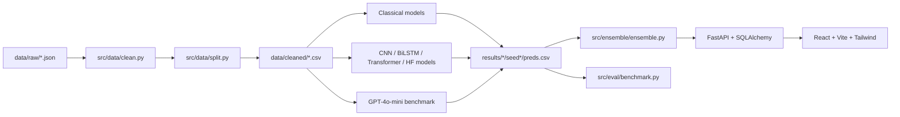

# DarkPatternGuard

DarkPatternGuard is an academic and engineering showcase for detecting
manipulative language in e-commerce copy. Given a product description, offer,
or checkout message, it predicts one of four classes:

| Class | Meaning |
| --- | --- |
| `Urgency` | Time pressure, countdowns, or expiring offers |
| `Scarcity` | Limited stock, availability, or quantity pressure |
| `Social Proof` | Popularity, reviews, or “people are buying” pressure |
| `Normal` | Neutral product or shopping language |

The project combines a provenance-preserving data pipeline, classical and
neural baselines, an LLM benchmark, validation-only ensembling, a FastAPI
serving layer, a React interface, SQLite/PostgreSQL persistence, Docker, CI,
and security checks.

## Research framing

### Problem statement

Dark patterns can push shoppers toward decisions they would not otherwise make.
The project asks whether lightweight linguistic features, neural text
classifiers, and a small instruction-following LLM can reliably distinguish
urgency, scarcity, and social-proof cues from ordinary e-commerce language.
The primary metric is macro-F1 because class frequencies are not assumed to be
balanced and minority-class failures matter as much as majority-class wins.
Precision, recall, per-class F1, calibration, confusion matrices, and bootstrap
confidence intervals are reported alongside it.

### Dataset origin and data novelty

The text corpus is the published `dataset/dataset.tsv` release from
[`yamanalab/ec-darkpattern`](https://github.com/yamanalab/ec-darkpattern), pinned
to commit `85ea9df31928d5ad6ea0b106316b441c201adbbe`. Its README attributes the
dark-pattern examples to Mathur et al. (2019) and describes the Normal examples
as non-dark e-commerce segments collected from the same sites. The repository
includes an Apache-2.0 license. The fetch script preserves selected raw records
and their page/category provenance under `data/raw/`; it does not add synthetic
Normal text or artificial HTML noise.

The source has four relevant categories: `Urgency`, `Scarcity`, `Social Proof`,
and `Not Dark Pattern`. The first three map directly to project labels;
`Not Dark Pattern` maps to `Normal`. Other labeled pattern categories are
excluded rather than relabeled. Our data novelty is the committed,
deterministic cleaning and group-aware splitting process:

1. accept JSON arrays, JSONL, or records nested under `records`, `data`, or
   `items`;
2. normalize Unicode with NFKC, strip HTML, remove URLs, lowercase, and
   collapse whitespace;
3. remove empty rows and exact duplicates using SHA-256 text hashes;
4. normalize labels to the four project classes;
5. retain the source page ID and original category for data lineage;
6. keep all segments from a source page in one stratified 80/10/10 partition
   to reduce page-level train/test leakage.

The cleaned CSVs, split manifest, class weights, and data card are generated
artifacts. The selected upstream rows include genuine non-dark examples, so the
cleaner's synthetic-neutral fallback is not used for this run. Raw and cleaned
counts, class distributions, and excluded categories are reported; model
metrics are not guaranteed to reach 95% or 100%. Fetch the pinned source and
regenerate the splits with `python scripts/fetch_princeton_raw.py` followed by
`make data`.

The real benchmark corpus contains **2,029 rows** from **956 source IDs**, split
by source page into **1,610 training**, **200 validation**, and **219 test**
rows. It contains **0 synthetic rows**. The split manifest is
[`data/cleaned/splits_manifest.json`](data/cleaned/splits_manifest.json), and the
full data card is [`data/DATA_CARD.md`](data/DATA_CARD.md).

## Architecture



## Models

| Family | Architecture/checkpoint | Role | Notes |
| --- | --- | --- | --- |
| Classical | Multinomial Naive Bayes | Baseline | Word TF-IDF 1–2 grams |
| Classical | Logistic Regression | Baseline | Word and character TF-IDF |
| Classical | Calibrated Linear SVM | Baseline | Probability calibration |
| Classical | LightGBM | Baseline | TF-IDF plus linguistic/statistical features |
| Neural | Kim CNN | New method | Filter widths 3, 4, 5; optional GloVe |
| Neural | 2-layer BiLSTM | New method | Trained from scratch |
| Neural | 4-layer small Transformer | New method | 256-dimensional custom BPE trained on train data |
| Neural | `bert-base-uncased` | Transformer baseline | Trainer-free weighted PyTorch loop |
| Neural | `distilbert-base-uncased` | Compact baseline | CPU-friendly checkpoint |
| Neural | `roberta-base` | Transformer comparison | Trainer-free fine-tuning |
| Neural | `microsoft/deberta-v3-base` | Novel architecture | Primary transformer comparison |
| LLM | `gpt-4o-mini` | JEV alternative benchmark | Zero-shot and five-shot JSON classification |

All model families use class-weighted loss where applicable, fixed seeds,
validation-only tuning, early stopping on validation macro-F1, gradient
clipping, and the shared prediction artifact format. Weights and caches are
never committed.

## Results

The following real-dataset results are from the grouped 219-row test split.
Macro-F1 is averaged over seeds 1729, 2718, and 3141; the interval is the mean
of each seed's bootstrap 95% confidence interval. Ensembles use validation
predictions for calibration or fitting. Weighted-average and stacking
validation predictions are out-of-fold.

### Real Test-Set Leaderboard

| Model | Test Macro-F1 (mean ± SD) | Mean bootstrap 95% CI |
| --- | ---: | ---: |
| `ensemble_weighted_average` | **0.9774 ± 0.0029** | 0.9464–1.0000 |
| `finetune_deberta` (`microsoft/deberta-v3-base`) | **0.9728 ± 0.0048** | 0.9385–0.9969 |
| `lightgbm` | 0.9687 ± 0.0000 | 0.9351–0.9934 |
| `ensemble_leave_one_out_logistic_regression` | 0.9654 ± 0.0031 | 0.9285–0.9924 |
| `ensemble_leave_one_out_naive_bayes` | 0.9654 ± 0.0031 | 0.9285–0.9924 |
| `ensemble_leave_one_out_cnn` | 0.9654 ± 0.0031 | 0.9285–0.9924 |
| `ensemble_leave_one_out_small_transformer` | 0.9639 ± 0.0028 | 0.9270–0.9910 |
| `ensemble_leave_one_out_bilstm` | 0.9636 ± 0.0031 | 0.9268–0.9910 |
| `ensemble_neural_only` | 0.9635 ± 0.0081 | 0.9242–0.9908 |
| `finetune_bert` (`bert-base-uncased`) | 0.9620 ± 0.0176 | 0.9216–0.9910 |
| `ensemble_soft_voting` | 0.9618 ± 0.0000 | 0.9244–0.9897 |
| `ensemble_without_llm` | 0.9618 ± 0.0000 | 0.9244–0.9897 |
| `ensemble_leave_one_out_lightgbm` | 0.9618 ± 0.0000 | 0.9244–0.9897 |
| `ensemble_leave_one_out_linear_svm` | 0.9618 ± 0.0000 | 0.9244–0.9897 |
| `ensemble_leave_one_out_finetune_bert` | 0.9604 ± 0.0025 | 0.9226–0.9883 |
| `ensemble_leave_one_out_finetune_deberta` | 0.9604 ± 0.0025 | 0.9226–0.9883 |
| `ensemble_stacking` | 0.9600 ± 0.0032 | 0.9204–0.9891 |
| `ensemble_classical_only` | 0.9569 ± 0.0000 | 0.9180–0.9855 |
| `linear_svm` | 0.9520 ± 0.0000 | 0.9096–0.9842 |
| `naive_bayes` | 0.9437 ± 0.0000 | 0.8985–0.9784 |
| `cnn` | 0.9389 ± 0.0129 | 0.8910–0.9752 |
| `logistic_regression` | 0.9345 ± 0.0000 | 0.8883–0.9704 |
| `small_transformer` | 0.9069 ± 0.0487 | 0.8548–0.9481 |
| `bilstm` | 0.8696 ± 0.0547 | 0.8078–0.9191 |

### BERT errors recovered by DeBERTa

These examples come from the real test split. DeBERTa predicted the true label
where BERT did not; seed IDs show where the recovery occurred.

| Test ID | Text | True label | BERT prediction | DeBERTa prediction | Seed(s) |
| ---: | --- | --- | --- | --- | --- |
| 23 | long dress style beach cover up with lace detail jessica in metairie, united states | Social Proof | Normal | Social Proof | 1729, 2718, 3141 |
| 57 | spring sale extended | Urgency | Normal | Urgency | 1729, 2718, 3141 |
| 0 | limited availability | Scarcity | Urgency | Scarcity | 3141 |
| 73 | extremely high demand: expect 2-4 weeks for it to arrive (to be safe). limit 4 per person! | Scarcity | Urgency | Scarcity | 3141 |
| 171 | an item you ordered is in high demand. no worries, we have prioritized your order. | Scarcity | Urgency | Scarcity | 3141 |

The generated [`results/leaderboard.md`](results/leaderboard.md) and
[`results/leaderboard.csv`](results/leaderboard.csv) contain the complete
metrics; [`results/errors.md`](results/errors.md) includes per-model error
summaries and the cross-seed comparison. Regenerate these results after changing
the data, configuration, or model code.

| Result | Location |
| --- | --- |
| Master leaderboard | [`results/leaderboard.md`](results/leaderboard.md) |
| Machine-readable leaderboard | [`results/leaderboard.csv`](results/leaderboard.csv) |
| Error analysis | [`results/errors.md`](results/errors.md) |
| Per-model predictions and metrics | `results/<model>/seed<seed>/` |

No numerical result is hard-coded here: regenerate the table after changing
data, configuration, or model code.

## Reproduction

Python 3.11 is required. Install backend dependencies:

```powershell
make setup
```

Run the stages in order:

```powershell
make data
make baselines
make neural
make llm                 # requires OPENAI_API_KEY for live calls
make ensemble
make report
```

The smoke path uses a deterministic 200-row exercise:

```powershell
make smoke
```

Run quality checks:

```powershell
make format-check
make lint
make test
```

Prefetch optional Hugging Face snapshots into an ignored cache:

```powershell
python scripts/fetch_models.py
```

### API and frontend

Create `.env` from `.env.example`, then start the API:

```powershell
make app
```

In another terminal:

```powershell
make frontend
```

The API is at `http://localhost:8000`, OpenAPI docs are at `/docs`, and the
Vite application is at `http://localhost:5173`. Set `VITE_API_URL` to point the
frontend at another API.

After real fine-tuning artifacts and a benchmark leaderboard are available,
the API serves the BERT or DeBERTa seed with the highest validation Macro-F1.
Its trained weights are loaded from `models_out`, and the matching Hugging Face
tokenizer/base weights must be available in the configured local cache. The API
marks the active model in `/models`; if a leaderboard exists without a matching
trained checkpoint, startup fails rather than silently serving heuristic
predictions. The heuristic fallback is only used before benchmark artifacts
exist.

### Docker

```powershell
docker compose up --build
```

The web service is exposed on port 80 and the API on port 8000. Compose
healthchecks gate web startup on API readiness. Set `DATABASE_URL`,
`USE_LLM_IN_API`, `OPENAI_API_KEY`, and `VITE_API_URL` through the environment;
secrets must never be placed in tracked files.

## Repository and script map

Every application directory has a local README where appropriate. The
following is the complete source-level map.

| Path | Purpose |
| --- | --- |
| `configs/` | YAML seeds and per-model hyperparameters |
| `configs/base.yaml` | Shared seeds, paths, labels, and max sequence length |
| `configs/cnn.yaml` | CNN training configuration |
| `configs/bilstm.yaml` | BiLSTM training configuration |
| `configs/small_transformer.yaml` | Small Transformer configuration |
| `configs/finetune.yaml` | Hugging Face loop configuration |
| `data/raw/` | Course-provided Princeton source JSON |
| `data/cleaned/` | Generated split CSVs and manifests (2,029 rows: 1,610 train, 200 validation, 219 test; 956 source IDs; 0 synthetic) |
| `docs/` | Method and preprocessing documentation |
| `src/data/clean.py` | Load, normalize, deduplicate, and balance records |
| `src/data/split.py` | Stratify data and write manifests/class weights |
| `src/models/classical.py` | Naive Bayes, logistic, SVM, and LightGBM |
| `src/models/cnn.py` | Kim-style CNN |
| `src/models/bilstm.py` | Two-layer BiLSTM |
| `src/models/small_transformer.py` | Custom-BPE Transformer |
| `src/models/finetune.py` | Trainer-free HF fine-tuning |
| `src/models/neural_common.py` | Shared neural training utilities |
| `src/models/llm.py` | Cached zero/five-shot GPT benchmark |
| `src/eval/metrics.py` | Metrics, calibration, bootstrap, and artifacts |
| `src/eval/benchmark.py` | Leaderboard, plots, and error analysis |
| `src/ensemble/ensemble.py` | Calibration, voting, weighting, stacking, ablations |
| `app/backend/main.py` | FastAPI endpoints, logging, persistence |
| `app/backend/database.py` | SQLAlchemy engine and sessions |
| `app/backend/models.py` | Prediction, feedback, and model-run ORM tables |
| `app/backend/models_registry.py` | Singleton CPU serving registry |
| `app/frontend/src/` | React pages, components, router, and API client |
| `scripts/run_stage.py` | Deterministic stage configuration check |
| `scripts/smoke.py` | 200-row pipeline smoke runner |
| `scripts/fetch_models.py` | Ignored Hugging Face cache prefetcher |
| `scripts/audit_repo.py` | Documentation and forbidden-artifact audit |
| `tests/` | Python unit and integration tests |
| `app/frontend/tests/` | Playwright browser smoke test |
| `alembic/` | Database migration environment and revisions |
| `results/` | Saved metrics, predictions, plots, and reports |
| `contributions/` | Individual contribution statement |

## Privacy, security, and release policy

The API stores a SHA-256 text hash and can omit raw text with
`privacy_flag=true`. Default request logs contain request metadata, status, and
latency, not submitted text. `.env`, API keys, model weights, caches, and local
databases are ignored. CI runs formatting, linting, tests, the smoke pipeline,
`pip-audit`, and `npm audit`.

This repository is released under the MIT License. See [`LICENSE`](LICENSE).
