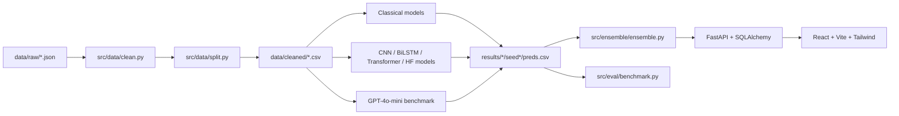

# DarkPatternGuard

DarkPatternGuard is an academic and engineering showcase for detecting
manipulative language in e-commerce copy. Given a product description, offer,
or checkout message, it predicts one of four classes:

| Class | Meaning |
| --- | --- |
| `Urgency` | Time pressure, countdowns, or expiring offers |
| `Scarcity` | Limited stock, availability, or quantity pressure |
| `Social Proof` | Popularity, reviews, or “people are buying” pressure |
| `Normal` | Neutral product or shopping language |

The project combines a provenance-preserving data pipeline, classical and
neural baselines, an LLM benchmark, validation-only ensembling, a FastAPI
serving layer, a React interface, SQLite/PostgreSQL persistence, Docker, CI,
and security checks.

## Research framing

### Problem statement

Dark patterns can push shoppers toward decisions they would not otherwise make.
The project asks whether lightweight linguistic features, neural text
classifiers, and a small instruction-following LLM can reliably distinguish
urgency, scarcity, and social-proof cues from ordinary e-commerce language.
The primary metric is macro-F1 because class frequencies are not assumed to be
balanced and minority-class failures matter as much as majority-class wins.
Precision, recall, per-class F1, calibration, confusion matrices, and bootstrap
confidence intervals are reported alongside it.

### Dataset origin and data novelty

The source corpus is the Princeton University e-commerce dark-pattern dataset
provided for this course project. The original export is retained as messy JSON
under `data/raw/`; no Kaggle or Hugging Face dataset is downloaded. Our data
novelty is the committed, deterministic cleaning and balancing process:

1. accept JSON arrays, JSONL, or records nested under `records`, `data`, or
   `items`;
2. normalize Unicode with NFKC, strip HTML, remove URLs, lowercase, and
   collapse whitespace;
3. remove empty rows and exact duplicates using SHA-256 text hashes;
4. normalize labels to the four project classes;
5. inject deterministic neutral product descriptions when `Normal` is absent
   or below the documented threshold, marking them `is_synthetic=true`;
6. create a stratified 80/10/10 train/validation/test split with the fixed
   seed in `configs/base.yaml`.

The cleaned CSVs, split manifest, class weights, and data card are generated
artifacts. Raw data and generated outputs must be supplied locally according
to the project data policy.

## Architecture



## Models

| Family | Architecture/checkpoint | Role | Notes |
| --- | --- | --- | --- |
| Classical | Multinomial Naive Bayes | Baseline | Word TF-IDF 1–2 grams |
| Classical | Logistic Regression | Baseline | Word and character TF-IDF |
| Classical | Calibrated Linear SVM | Baseline | Probability calibration |
| Classical | LightGBM | Baseline | TF-IDF plus linguistic/statistical features |
| Neural | Kim CNN | New method | Filter widths 3, 4, 5; optional GloVe |
| Neural | 2-layer BiLSTM | New method | Trained from scratch |
| Neural | 4-layer small Transformer | New method | 256-dimensional custom BPE trained on train data |
| Neural | `bert-base-uncased` | Transformer baseline | Trainer-free weighted PyTorch loop |
| Neural | `distilbert-base-uncased` | Compact baseline | CPU-friendly checkpoint |
| Neural | `roberta-base` | Transformer comparison | Trainer-free fine-tuning |
| Neural | `microsoft/deberta-v3-base` | Novel architecture | Primary transformer comparison |
| LLM | `gpt-4o-mini` | JEV alternative benchmark | Zero-shot and five-shot JSON classification |

All model families use class-weighted loss where applicable, fixed seeds,
validation-only tuning, early stopping on validation macro-F1, gradient
clipping, and the shared prediction artifact format. Weights and caches are
never committed.

## Results

The reproducible master leaderboard is generated from saved predictions by
`src/eval/benchmark.py` and is published at
[`results/leaderboard.md`](results/leaderboard.md) when the benchmark has been
run. It includes mean ± standard deviation over seeds, bootstrap confidence
intervals, parameter counts, training time, inference latency, and LLM cost.

| Result | Location |
| --- | --- |
| Master leaderboard | [`results/leaderboard.md`](results/leaderboard.md) |
| Machine-readable leaderboard | [`results/leaderboard.csv`](results/leaderboard.csv) |
| Error analysis | [`results/errors.md`](results/errors.md) |
| Per-model predictions and metrics | `results/<model>/seed<seed>/` |

No numerical result is hard-coded here: regenerate the table after changing
data, configuration, or model code.

## Reproduction

Python 3.11 is required. Install backend dependencies:

```powershell
make setup
```

Run the stages in order:

```powershell
make data
make baselines
make neural
make llm                 # requires OPENAI_API_KEY for live calls
make ensemble
make report
```

The smoke path uses a deterministic 200-row exercise:

```powershell
make smoke
```

Run quality checks:

```powershell
make format-check
make lint
make test
```

Prefetch optional Hugging Face snapshots into an ignored cache:

```powershell
python scripts/fetch_models.py
```

### API and frontend

Create `.env` from `.env.example`, then start the API:

```powershell
make app
```

In another terminal:

```powershell
make frontend
```

The API is at `http://localhost:8000`, OpenAPI docs are at `/docs`, and the
Vite application is at `http://localhost:5173`. Set `VITE_API_URL` to point the
frontend at another API.

### Docker

```powershell
docker compose up --build
```

The web service is exposed on port 80 and the API on port 8000. Compose
healthchecks gate web startup on API readiness. Set `DATABASE_URL`,
`USE_LLM_IN_API`, `OPENAI_API_KEY`, and `VITE_API_URL` through the environment;
secrets must never be placed in tracked files.

## Repository and script map

Every application directory has a local README where appropriate. The
following is the complete source-level map.

| Path | Purpose |
| --- | --- |
| `configs/` | YAML seeds and per-model hyperparameters |
| `configs/base.yaml` | Shared seeds, paths, labels, and max sequence length |
| `configs/cnn.yaml` | CNN training configuration |
| `configs/bilstm.yaml` | BiLSTM training configuration |
| `configs/small_transformer.yaml` | Small Transformer configuration |
| `configs/finetune.yaml` | Hugging Face loop configuration |
| `data/raw/` | Course-provided Princeton source JSON |
| `data/cleaned/` | Generated split CSVs and manifests |
| `docs/` | Method and preprocessing documentation |
| `src/data/clean.py` | Load, normalize, deduplicate, and balance records |
| `src/data/split.py` | Stratify data and write manifests/class weights |
| `src/models/classical.py` | Naive Bayes, logistic, SVM, and LightGBM |
| `src/models/cnn.py` | Kim-style CNN |
| `src/models/bilstm.py` | Two-layer BiLSTM |
| `src/models/small_transformer.py` | Custom-BPE Transformer |
| `src/models/finetune.py` | Trainer-free HF fine-tuning |
| `src/models/neural_common.py` | Shared neural training utilities |
| `src/models/llm.py` | Cached zero/five-shot GPT benchmark |
| `src/eval/metrics.py` | Metrics, calibration, bootstrap, and artifacts |
| `src/eval/benchmark.py` | Leaderboard, plots, and error analysis |
| `src/ensemble/ensemble.py` | Calibration, voting, weighting, stacking, ablations |
| `app/backend/main.py` | FastAPI endpoints, logging, persistence |
| `app/backend/database.py` | SQLAlchemy engine and sessions |
| `app/backend/models.py` | Prediction, feedback, and model-run ORM tables |
| `app/backend/models_registry.py` | Singleton CPU serving registry |
| `app/frontend/src/` | React pages, components, router, and API client |
| `scripts/run_stage.py` | Deterministic stage configuration check |
| `scripts/smoke.py` | 200-row pipeline smoke runner |
| `scripts/fetch_models.py` | Ignored Hugging Face cache prefetcher |
| `scripts/audit_repo.py` | Documentation and forbidden-artifact audit |
| `tests/` | Python unit and integration tests |
| `app/frontend/tests/` | Playwright browser smoke test |
| `alembic/` | Database migration environment and revisions |
| `results/` | Saved metrics, predictions, plots, and reports |
| `contributions/` | Individual contribution statement |

## Privacy, security, and release policy

The API stores a SHA-256 text hash and can omit raw text with
`privacy_flag=true`. Default request logs contain request metadata, status, and
latency, not submitted text. `.env`, API keys, model weights, caches, and local
databases are ignored. CI runs formatting, linting, tests, the smoke pipeline,
`pip-audit`, and `npm audit`.

This repository is released under the MIT License. See [`LICENSE`](LICENSE).
